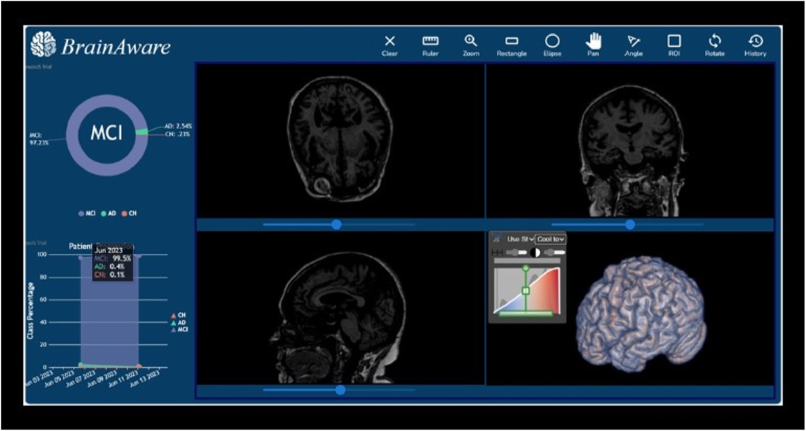
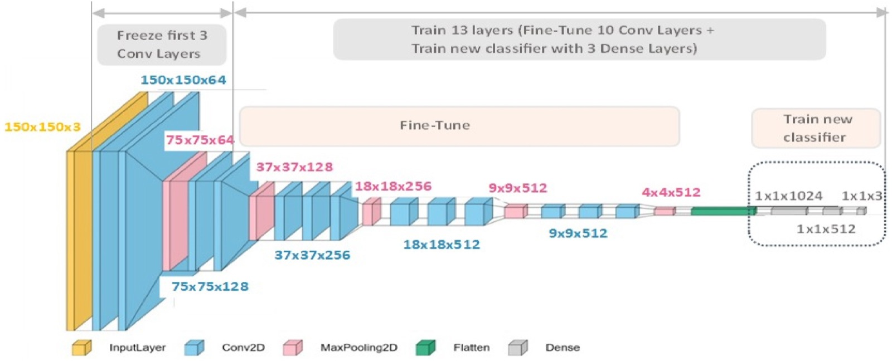

<h1 align="center">BrainAware · Early Alzheimer's Detection</h1>

<p align="center">
  Hippocampus-focused VGG16 that classifies brain MRI into <b>CN / MCI / AD</b>, wrapped in a web app for radiologists.
</p>

<p align="center">
  <a href="https://doi.org/10.1016/j.heliyon.2024.e29375"></a>
  
  
  
  
</p>

<p align="center">
  
</p>

## Paper

**AI-based tool for early detection of Alzheimer's disease**, *Heliyon* 10(8), e29375, 2024.
[Read it here](https://doi.org/10.1016/j.heliyon.2024.e29375)

## What it does

- Upload a NIfTI or DICOM brain MRI and get class probabilities for CN, MCI and AD.
- View the scan in axial, coronal, sagittal and full 3D.
- Every upload is saved with the patient, so you can track how the case changes over time.

## How it works

1. **Data**: ADNI T1-weighted MRI, 1,598 subjects (339 AD, 452 CN, 807 MCI).
2. **Preprocessing**: register to MNI152, segment the hippocampus with FSL, keep only hippocampus slices, skull strip, remove background, resize to 150×150.
3. **Model**: VGG16 pretrained on ImageNet. First 3 conv layers frozen, the rest fine-tuned, new head with Dense 1024 → 512 → 3.
4. **Training**: Adam (lr 1e-3, decay 0.96), batch size 64, class weights for imbalance. Augmentation strength goes up step by step during training (progressive augmentation).

<p align="center">
  
</p>

## Results

| Split | Accuracy | Loss |
|---|---|---|
| Train | 99.62% | 0.019 |
| Validation | 97.52% | 0.086 |
| **Test (10-fold CV)** | **98.17%** | 0.077 |

| Class | Precision | Recall | F1 |
|---|---|---|---|
| AD | 0.99 | 0.96 | 0.98 |
| CN | 0.98 | 0.99 | 0.99 |
| MCI | 0.97 | 0.99 | 0.98 |

## Repo structure

```
model/
  preprocessing/   registration + hippocampus slice extraction (notebooks)
  training/        VGG16 training
  predict.py       run the model on a scan
backend/           Django REST API: auth, uploads, prediction, patient history
frontend/          React app: DICOM viewer (Cornerstone), 3D view (vtk.js), charts
tools/             NIfTI → DICOM / PNG / VTK conversion
docs/figures/      figures from the paper
```

## Run it

**Model weights**: download `vgg16_ad.h5` from [Releases](../../releases) and put it in `backend/images/`.

**Backend**

```bash
cd backend
cp .env.example .env        # set DJANGO_SECRET_KEY
docker compose up --build   # http://localhost:8000
```

**Frontend**

```bash
cd frontend
npm install
npm start                   # http://localhost:3000
```

The API URL is set in `frontend/src/server_config.json`.

## Data

The model is trained on [ADNI](https://adni.loni.usc.edu/). The data isn't included here because ADNI doesn't allow redistribution, so request access from them.

## Limitations

- Trained and tested only on ADNI. It still needs validation on external datasets.
- Hippocampus segmentation and skull stripping rely on FSL. The next step is to replace them with a trained model.
- Research project. Not for clinical use.

## Team

Built by Mohamed Hafez, Noha Tarek, Caroline Magdy, Mohammed Kamel and Alaa Melek.
Supervised by Ibrahim Sadek.
Co-authors: Lamees N. Mahmoud and Shafiq Ul Rehman.

## Citation

```bibtex
@article{rehman2024alzheimer,
  title   = {AI-based tool for early detection of Alzheimer's disease},
  author  = {Rehman, Shafiq Ul and Tarek, Noha and Magdy, Caroline and Kamel, Mohammed and
             Abdelhalim, Mohammed and Melek, Alaa and Mahmoud, Lamees N. and Sadek, Ibrahim},
  journal = {Heliyon},
  volume  = {10},
  number  = {8},
  pages   = {e29375},
  year    = {2024},
  doi     = {10.1016/j.heliyon.2024.e29375}
}
```

Figures are from the paper (CC BY-NC 4.0).
